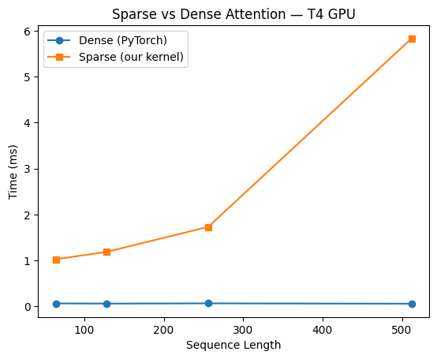
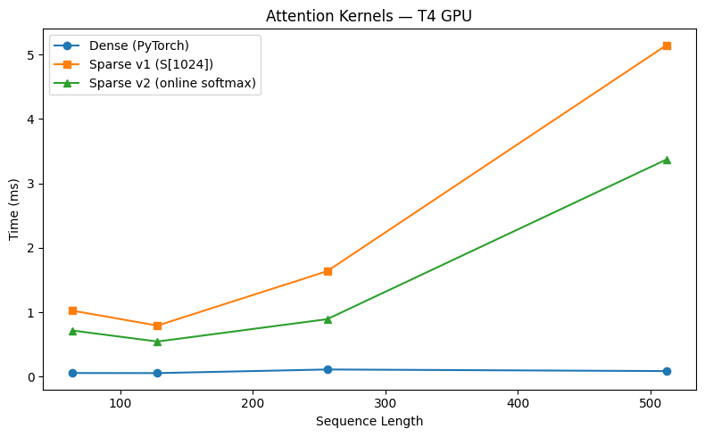

# Sparse attention

This is an exploratory project to implement a CUDA kernel for sparse attention and benchmark its performance against PyTorch's dense attention. Built this to understand what actually happens inside Flash Attention , not just use it as a black box.

The core idea: instead of computing attention between every pair of tokens (O(n²)), define a sparsity pattern and skip tiles that have no active token pairs entirely. The pattern used here is a local window of `w` nearby tokens plus global tokens every `s` steps , same idea as Longformer.

---

## Files

| File | What it is |
|------|------------|
| `csrc/sparse_attention.cu` | The CUDA kernels: naive baseline, v1 (tiled shared memory), v2 (online softmax), and their launchers |
| `csrc/sparse_attention_ext.cpp` | pybind11 wrapper that exposes the kernels as a PyTorch extension |
| `setup.py` | Compiles everything via `CUDAExtension` (prints registers and spills per kernel) |
| `reference.py` | Sparsity mask builder and the fp64 reference attention used by tests and benchmarks |
| `tests/test_correctness.py` | Every kernel against the reference, including N that isn't a multiple of 16 |
| `bench/bench.py`, `bench/plot.py` | Benchmark against PyTorch baselines up to N=8192, then plot |
| `bench/profile.py` | Runs one kernel once, for Nsight Compute |
| `benchmark.ipynb` | Original Colab notebook (historical) |
| `PLAN.md` | Step-by-step upgrade plan, one big idea per phase |
| `log.md` | Dev log of every iteration, what broke, and why |

---

## Progress

| Phase | Idea | Status |
|---|---|---|
| 0 | Measurement foundation: tests, benchmark, profiling | done |
| 1 | Precomputed active-tile list (v3) | next |
| 2 | Thread mapping: no redundant work, coalescing, occupancy (v4) | planned |
| 3 | Double buffering (v5) | planned |
| 4 | Tensor cores, fp16 WMMA (v6) | planned |
| 5 | Batch + multi-head (v7) | planned |
| 6 | Backward pass with recomputation (v8) | planned |
| 7 | `nn.Module` + final write-up | planned |

---

## Build, test, benchmark

Tested on a Colab T4 GPU (CUDA 12.8, Python 3.12). From the repo root:

```bash
pip install -r requirements.txt
python setup.py build_ext --inplace     # prints registers / spill bytes per kernel
pytest -q tests                         # correctness vs fp64 reference
python -m bench.bench                   # writes bench/results/results.csv
python -m bench.plot                    # writes assets/bench_w*_s*.png
```

Profile one kernel with Nsight Compute:

```bash
ncu --set full -k regex:flash_attention -c 1 -o bench/results/v2_n4096 python -m bench.profile --kernel v2 --n 4096
```

---

## Usage

```python
import torch
import sparse_attention as sa
from reference import build_mask

N, D = 512, 64
Q, K, V = (torch.randn(N, D, device="cuda") for _ in range(3))

# local window=32, global stride=512
mask = build_mask(N, window=32, stride=512).int().contiguous()

O = sa.sparse_attention_v2(Q, K, V, mask)  # v2: online softmax
# O = sa.sparse_attention(Q, K, V, mask)   # v1: tiled, full score row (N <= 1024)
# O = sa.naive_attention(Q, K, V)          # naive dense baseline (N <= 1024)
```

Inputs must be contiguous float32 CUDA tensors of shape `[N, 64]`, and the mask must be int32 `[N, N]`.

---

## How it works

### Sparsity pattern
Each query token `i` attends only to:
- **Local window**: tokens within distance `w` → `abs(i-j) <= w`
- **Global stride**: every `s`-th token → `j % s == 0`

Everything else is masked out. The kernel checks each K/V tile before loading it — if no token pair in that tile is active, the tile is skipped entirely.

### v1 — tiled shared memory
Loads Q/K/V tiles into shared memory (SRAM) cooperatively so threads don't each fetch their own copy from global memory. Stores the full score array `S[N]` per thread, softmaxes at the end. Works, but `S[N]` spills to global memory as N grows — O(N) register usage per thread, which is why it gets slow fast.

### v2 — online softmax
Replaces `S[N]` with four scalars per thread: running max `m`, running denominator `l`, running output `acc`, and the thread's output column `j`. Updates these incrementally as each tile arrives — never needs to store the full score array. O(1) memory per thread regardless of sequence length. This is the core idea from the Flash Attention paper.

---

## Results

### v1 vs Dense (PyTorch)


### v1 vs v2 vs Dense


| N | Dense (PyTorch) | v1 | v2 | v2 speedup over v1 |
|---|---|---|---|---|
| 64 | 0.058 ms | 1.026 ms | 0.717 ms | 1.43× |
| 128 | 0.057 ms | 0.794 ms | 0.547 ms | 1.45× |
| 256 | 0.113 ms | 1.638 ms | 0.894 ms | 1.83× |
| 512 | 0.088 ms | 5.145 ms | 3.371 ms | 1.53× |

> **Caveat (found in Phase 0):** these numbers predate the correctness harness. The v1 kernel was computing a wrong answer then (masked keys got score 0 instead of −∞). Also, with window=2 and stride=4, every 16-wide tile holds a global token, so **no tile was ever skipped**. These numbers measure dense tiled attention. New results with a genuinely sparse pattern (window=32, stride=512) come from `bench/bench.py`. See `log.md`, Entry 8.

Both custom kernels are slower than PyTorch dense at these sequence lengths. That's expected — PyTorch uses cuBLAS which is optimized at the assembly level. The sparsity advantage should show up at N ≥ 2048 where skipping O(n²) tiles actually saves meaningful work vs the kernel launch overhead.

The more interesting result is v2 vs v1 — the online softmax rewrite gives a consistent 1.4–1.8× speedup just by eliminating the `S[N]` array. Same algorithm, same sparsity pattern, just better memory behavior.

---

## Key things learned

**Flat indexing** Python slice is easy to use. It took me a while to get used to flat indexing and be able to mentally calculate them.

**`__syncthreads()` has two jobs, not one.** One call protects reads (don't read shared memory before everyone's written to it), another protects writes (don't overwrite the tile before everyone's done reading it). 

**Shared memory size must be known at compile time.** You can't do `__shared__ float Qs[Br][d]` if `d` is a runtime variable. Either hardcode it, use a template parameter, or use dynamic shared memory with `extern __shared__`.

**Register pressure is a real constraint.** `float S[1024]` looks innocent but puts 1024 floats per thread into local memory, which spills to global memory when registers run out. With 1024 threads per block that's enough to hit `cudaErrorLaunchOutOfResources` before the kernel even starts. The fix **online softmax** isn't just algorithmically cleaner, it's what makes the kernel actually launchable at scale.

**Doing extra work to avoid work can backfire.** The `any_active` sparsity check inside the kernel reads global memory for every tile to decide whether to skip it. At short sequences this overhead dominates any savings from skipping. Precomputing the active tile list on the CPU and passing it in would remove this entirely.


---

## What's next

The full step-by-step plan is in [`PLAN.md`](PLAN.md). Next up is Phase 1: precompute the list of active `(row_tile, col_tile)` pairs on the CPU and pass it in, so the kernel walks a list instead of scanning an N×N mask for every tile.
